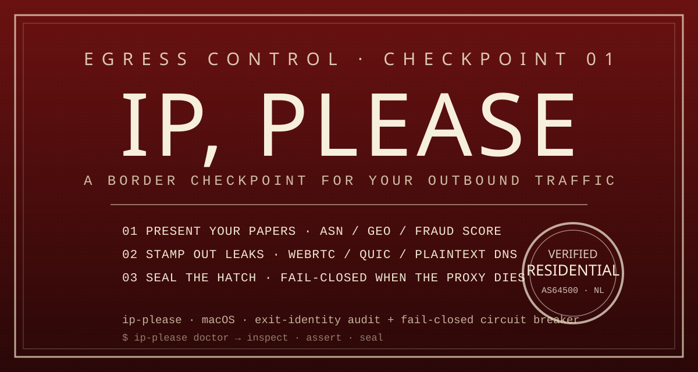
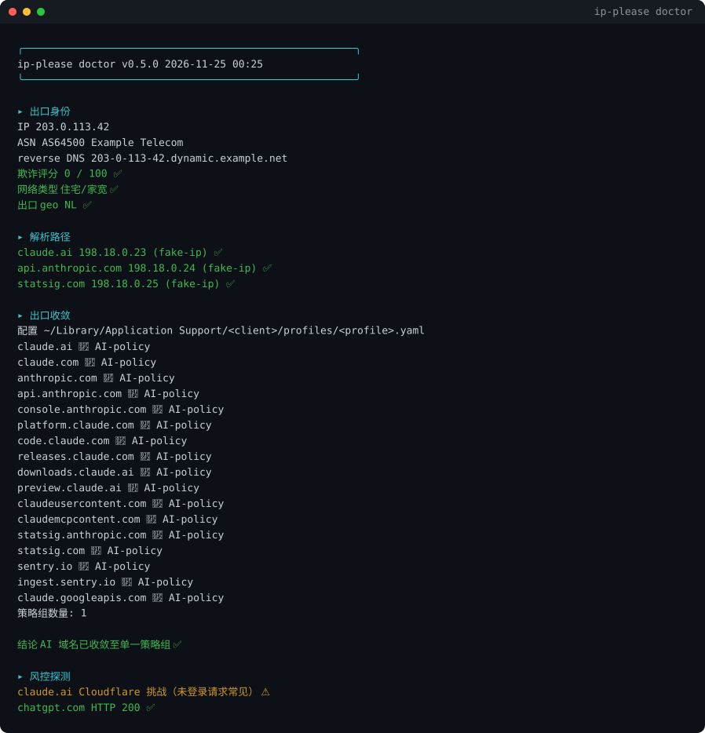

# ip-please

[](https://github.com/zahT3/ip-please/actions/workflows/ci.yml)
[](LICENSE)
[](https://github.com/zahT3/ip-please/releases)

**Egress-identity auditor and fail-closed circuit breaker for AI accounts on macOS.**

[中文说明](README.zh-CN.md) · [Changelog](CHANGELOG.md) · [Security](SECURITY.md)

**Not a command-line person?** There is a copy-paste installer — see [Quickstart](docs/quickstart.md).

```bash
bash -c "$(curl -fsSL https://raw.githubusercontent.com/zahT3/ip-please/main/scripts/quickstart.sh)"
```

Or download the unsigned `.pkg` from [Releases](https://github.com/zahT3/ip-please/releases/latest) (Apple Silicon; needs one manual Gatekeeper approval).



Every outbound connection crosses a border. `ip-please` runs the checkpoint on your Mac: each connection must present its papers (ASN, geo, fraud score, reverse DNS), the known smuggling routes get patted down (WebRTC, QUIC, plaintext DNS, unconverged policy groups), and when the proxy path dies the hatch is sealed instead of letting your real address walk out.

The tool is decoupled from any provider: it only audits and controls how *this machine* reaches the network.

> The repository is one letter off the door-ID games: **IP, please**. The metaphor underneath is an airlock — seal the hatch when the pressure drops.



## Threat model

| Surface | Observer | Visible signals |
|---|---|---|
| Exit identity | Server / CDN / risk engine | IP, ASN, geo, reverse DNS, fraud score, request timing |
| Leak paths | Local machine | WebRTC non-proxied UDP, QUIC, plaintext DNS, unconverged policy groups |
| Failure domain | Proxy client | Transparent direct connections during crash or restart windows |

## Scope: account survival, not IP vanity

The goal is keeping the account alive; the mechanism is controlling the egress surface. It covers the network-side ban signals and nothing else.

| Ban signal | Covered | How |
|---|---|---|
| Exit IP reputation (datacenter / VPN flag / fraud score) | yes | `ip` audit, pinned residential node |
| Exposure through leaks (WebRTC, QUIC, plaintext DNS, bypass domains) | yes | `dns` + `egress` assertions, `guard` fail-closed |
| Environment mismatch (timezone / language / geo) | yes | `fingerprint` |
| Local residue (cookies, tokens, device traces) | partial | `residue` scan, manual purge |
| Payment or billing-region mismatch | no | out of scope |
| Account sharing, multi-device IP churn | no | policy, not tooling |
| Behavioural or content triggers | no | out of scope |
| Third-party session tools (usage trackers, relays) | no | uninstall them |

## Design invariants

1. **Exit is verifiable** — read the actual exit attributes at any time and compare them against the expected configuration, field by field.
2. **Leak surfaces are enumerable** — assert each of the four known bypasses instead of assuming they are fine.
3. **Failures converge** — apply fail-closed blocking to web egress when the proxy dies, overriding the client's default fail-open behaviour.
4. **Self-recoverable** — every blocking path ships an escape hatch and a TTL rollback, so the operator is never locked out.

## Install

```bash
git clone https://github.com/zahT3/ip-please
cd ip-please
cp config.example.sh config.sh   # PROXY_PORT / EXPECT_COUNTRY / PROFILE_DIR
./install.sh                     # pause -> install -> verify -> arm
```

`install.sh` runs in a fixed order: write the exemption marker first, then change any network state. If verification fails, nothing is armed; on an abnormal exit the exemption remains.

After install the `ip-please` command is symlinked into `~/.local/bin/ip-please`.

Homebrew:

```bash
brew install zahT3/tap/ip-please
# system side (writes /etc, loads launchd, needs sudo)
"$(brew --prefix ip-please)/libexec/install.sh"
```

## Commands

| Command | Semantics |
|---|---|
| `ipp doctor` | Full audit; non-zero exit code when any check drifts |
| `ipp ip` | Exit identity: ASN, reverse DNS, fraud score, residential/datacenter, geo |
| `ipp dns` | Resolution path assertion: `claude.ai` and friends must land in the fake-ip range |
| `ipp egress [--fix]` | Egress convergence: do all AI domains hit one policy group; `--fix` folds stray domains in |
| `ipp fingerprint` | Environment consistency: timezone, language and region (decodes AppleLocale `@rg=` overrides) vs exit geo |
| `ipp risk` | Risk surface: detect a Cloudflare challenge |
| `ipp guard <sub>` | Circuit breaker: `status` / `install` / `pause` / `resume` / `remove` / `test` / `test-soft` |
| `ipp panic` | Emergency release of the breaker |
| `ipp residue [--purge]` | Local residue scan / cleanup (before switching accounts) |


Short forms: `ipp` (primary), plus `ipplz`, `ip-please`, `airlock` aliases. The repository stays `ip-please`.

Global flags: `--profile <path>` to pick a subscription file; `--plain` / `--stack` / `--badge` / `--unicode` for output style; `--redact` replaces the real exit identity with example values before printing, so output is safe to screenshot and share.

## The circuit breaker

Scheduled by launchd every 5 seconds:

```
        port up                        port up
  ┌──────────────────► STANDBY ◄──────────────────┐
  │                      │                        │
  │                 port down                     │
  │                      ▼                        │
  │             GRACE(120s) ──▶ BLOCK ──900s──▶ OPEN(3600s)
  │                              │                 │
  └──────────────────────────────┴─────────────────┘
                 pause flag ──▶ clear(BLOCK|OPEN)
```

| State | Behaviour |
|---|---|
| STANDBY | pf anchor rules empty, zero forwarding overhead |
| GRACE | Proxy restart window, no blocking yet |
| BLOCK | Block outbound TCP 80/443/8080/8443 and UDP 443/3478/5349/19302 |
| OPEN | TTL rollback: allow egress for 3600 s and log it, to keep the host reachable |
| pause | Clear pf rules and the cooldown timer; immediate operational control |

After loading rules the breaker verifies the rule count via `pfctl -a ip-please-guard -sr`; a missing pf anchor is re-registered and `pf.conf` reloaded; failures are logged only — success is never reported without verification.

The breaker only blocks; it does not start your proxy client. Set `RELAUNCH_APP="FlClash"` to have it try once per block episode.

**Operating rule: `ipp guard pause` → change → verify → `ipp guard resume`.** Enforced by tests.

Region mismatches are a warning by default (common on dev machines); set `FINGERPRINT_STRICT=1` in `config.sh` to make any region mismatch fail.

## Why interval, not a resident daemon

Each tick costs ~40 ms including ten forked helpers, runs every 5 s, and holds **zero** memory between ticks. A resident root daemon would keep 3–5 MB and a much larger attack surface alive 24/7, lose its state on a crash, and require a restart to ship a fix. The interval design is stateless (all state in `/var/run`), idempotent, and upgradeable by replacing a file.

## Testing

```bash
make check     # shellcheck + python/bash syntax + 22 regression assertions
```

- `guard_state_test.sh` — state machine: STANDBY, BLOCK, pause, TTL rollback, anchor self-heal
- `rules_parser_test.sh` — rule parsing: escape decoding, suffix matching, missing `rules:` exit code, `--fix` idempotence
- `install_order_test.sh` — install ordering: pause before install, arm only after verification, abort on failure, sudo on every `pf.conf` edit

## Dependencies

macOS built-ins only: bash 3.2, pfctl, launchctl, curl, python3 (Xcode CLT).

## Contributing

See [CONTRIBUTING.md](CONTRIBUTING.md), [SECURITY.md](SECURITY.md), and [CODE_OF_CONDUCT.md](CODE_OF_CONDUCT.md). Licensed under [MIT](LICENSE).

## Limitations

- macOS only.
- Bring your own proxy client (FlClash / Clash Verge Rev / mihomo / sing-box).
- `egress --fix` edits a local subscription file; rerun after the subscription updates, otherwise `doctor` reports drift.
- With several subscription files the newest mtime wins; pass `--profile` to be explicit.
- No mobile coverage (system-level VPN on iOS/Android has no such bypass path).
