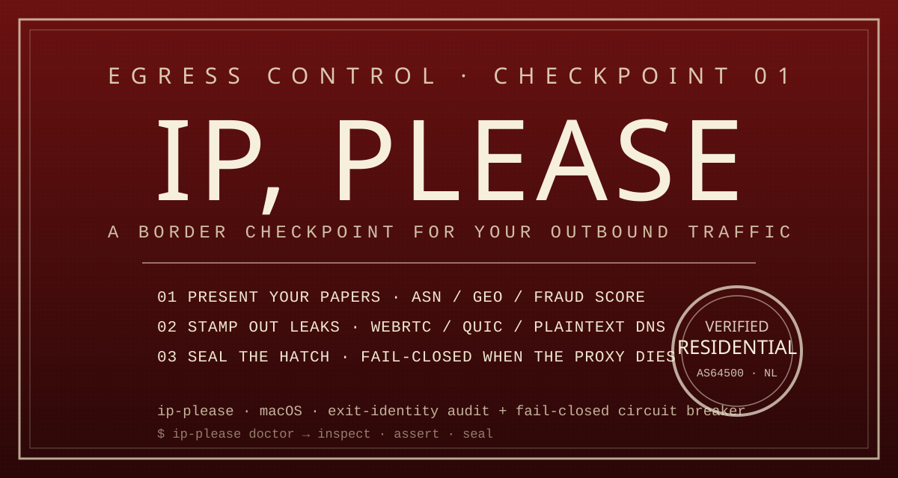
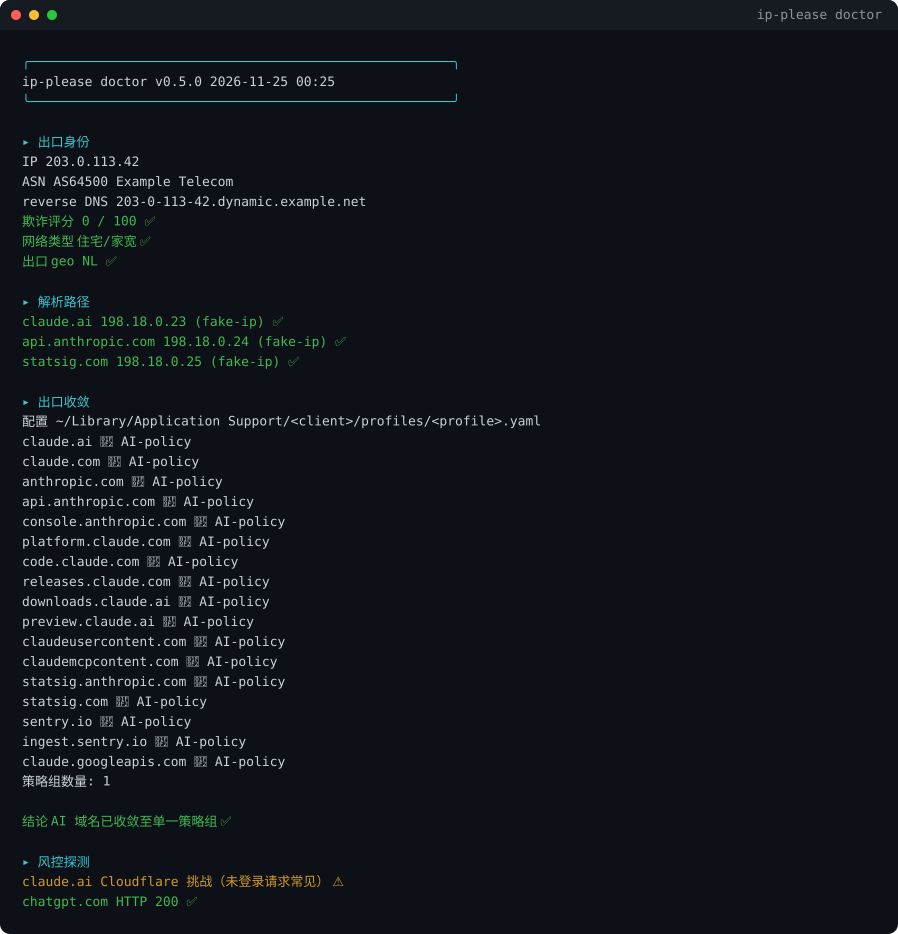

# ip-please

[](https://github.com/zahT3/ip-please/actions/workflows/ci.yml)
[](LICENSE)
[](https://github.com/zahT3/ip-please/releases)

**macOS 下的 AI 账号出口身份审计与防泄漏熔断 CLI**

[English](README.md) · [变更记录](CHANGELOG.md) · [安全策略](SECURITY.md)

**不懂命令行？** 有复制粘贴就能装好的版本 —— 见 [小白安装指南](docs/quickstart.zh-CN.md)。

**想系统了解？** 读 [101 手册](docs/handbook.zh-CN.md)：全流程、哪些是全自动、哪些要手动、以及一份完整 QA。

```bash
bash -c "$(curl -fsSL https://raw.githubusercontent.com/zahT3/ip-please/main/scripts/quickstart.sh)"
```

或者从 [Releases](https://github.com/zahT3/ip-please/releases/latest) 下载未签名的 `.pkg` 双击安装（Apple Silicon；首次需在系统设置里手动放行）。



每次出网都是一次过关。`ip-please` 在 Mac 上设下这道关口：核验每个连接的出口身份（ASN、geo、欺诈评分、反向域名），排查四类已知泄漏路径（WebRTC、QUIC、明文 DNS、未完成出口收敛的策略组）。一旦代理链路中断，出站熔断器立即触发 fail-closed 阻断，防止真实地址直连泄漏。

工具与上层服务解耦，仅审计并控制本机的出站状态。

> 仓库名把「ID, please」改了一个字母：**IP, please**。底层设计遵循气闸模型——失压时锁死舱门。



## 威胁模型

| 面 | 观测方 | 可见信号 |
|---|---|---|
| 出口身份 | 服务端 / CDN / 风控 | IP、ASN、geo、reverse DNS、欺诈评分、请求时序 |
| 泄漏路径 | 本机 | WebRTC 非代理 UDP、QUIC、明文 DNS、未完成出口收敛的策略组 |
| 故障域 | 代理客户端 | 进程崩溃或重启窗口内的透明直连 |

## 边界：保号，不是 IP 洁癖

目标是保住账号，手段是管住出站面。工具仅覆盖网络侧的封号信号，不涉及其他维度。

| 封号信号 | 是否覆盖 | 手段 |
|---|---|---|
| 出口 IP 信誉（机房 / VPN 标记 / 欺诈评分） | 是 | `ip` 审计 + 固定住宅节点 |
| 泄漏暴露（WebRTC、QUIC、明文 DNS、旁路域名） | 是 | `dns` + `egress` 断言，`guard` fail-closed |
| 环境不一致（时区 / 语言 / geo） | 是 | `fingerprint` |
| 本地残留（cookie、token、设备痕迹） | 部分 | `residue` 扫描 + 手动清理 |
| 支付方式或账单地区不一致 | 否 | 不在工具范围 |
| 账号共享、多设备 IP 漂移 | 否 | 属使用纪律，不属工具 |
| 行为与内容触发 | 否 | 不在工具范围 |
| 第三方会话工具（用量面板、中转站） | 否 | 直接卸载 |

## 设计约束

1. **出口身份可验证** —— 实时读取实际出口属性，与预期配置逐项比对。
2. **泄漏面可枚举** —— 逐项断言四类已知旁路，替代经验假设。
3. **故障可收敛** —— 代理失活时对 Web 流量执行 fail-closed 阻断，覆盖客户端默认的 fail-open 行为。
4. **自身可恢复** —— 阻断路径内置熔断豁免标记与 TTL 自动回退，保留运维接管通道。

## 配置

把偏好写进 `~/.config/ip-please/config.sh` 即可（brew 安装同样生效）：

```bash
AI_GROUP="🧲 海外AI"      # 你的 AI 策略组名
PROXY_PORT=7890           # 客户端混合端口
RELAUNCH_APP="FlClash"    # 熔断后尝试拉起
```

## 安装

```bash
git clone https://github.com/zahT3/ip-please
cd ip-please
cp config.example.sh config.sh   # PROXY_PORT / EXPECT_COUNTRY / PROFILE_DIR
./install.sh                     # pause -> install -> verify -> arm
```

`install.sh` 严格按序执行：先写入熔断豁免标记，再修改网络配置；校验失败即中止生效，异常退出时保留熔断豁免状态。

安装完成后，可执行文件软链至 `~/.local/bin/ip-please`。

Homebrew：

```bash
brew install zahT3/tap/ip-please
# 系统侧组件（写 /etc、调用 launchctl 加载服务，需要 sudo）
"$(brew --prefix ip-please)/libexec/install.sh"
```

## 安装器会改什么

| 对象 | 改动 |
|---|---|
| Claude Code | 写入代理变量（`HTTP_PROXY` / `socks5h`）并**关闭遥测**（5 个环境变量）；`IP_PLEASE_KEEP_TELEMETRY=1` 可保留 |
| Claude Desktop | 不改配置：训练数据开关「Help improve Claude」在 设置 → 隐私，需手动关；崩溃/分析遥测消费版无界面开关。工具只保证流量走同一出口 |
| 浏览器 | 写入 WebRTC / QUIC 策略（Chrome、Brave） |
| 系统 | IPv6 关闭；pf 锚点 + launchd 熔断器 |
| 网络出口 | 不做任何代理/订阅配置——那部分需要你自己装客户端 |

## 命令

| 命令 | 语义 |
|---|---|
| `ipp doctor` | 全量状态审计；任一检查项偏离预期即返回非零退出码 |
| `ipp ip` | 出口身份核验：ASN、reverse DNS、欺诈评分、住宅/机房属性、geo |
| `ipp dns` | 解析路径断言：验证 `claude.ai` 等域名解析结果落于 fake-ip 网段 |
| `ipp egress [--fix]` | 出口收敛：审计目标 AI 域名是否命中单一策略组；`--fix` 自动归并旁路域名 |
| `ipp fingerprint` | 环境一致性：校验时区、语言、地区（会解码 AppleLocale 的 `@rg=` 区域覆盖）与出口 geo 是否对齐 |
| `ipp risk` | 风控探测：检测目标站点是否返回 Cloudflare challenge |
| `ipp guard <sub>` | 出站熔断器控制：`status` / `install` / `pause` / `resume` / `remove` / `test` / `test-soft` |
| `ipp panic` | 应急解除熔断（网络被阻断时使用） |
| `ipp recover [--restart]` | FlClash 崩溃后的残留恢复：清 DNS/系统代理，可选重启客户端 |
| `ipp activity` | 检测 Claude 是否在活动（暂停/重启前必查） |
| `ipp guard pause --for 180` | 限时暂停，到点自动恢复 |
| `ipp residue [--purge]` | 本地残留扫描与清理（切换账号前执行） |


短命令：`ipp`（主用），另有 `ipplz` / `ip-please` / `airlock` 别名；仓库名保持 `ip-please`。

全局参数：`--profile <path>` 指定订阅文件；`--plain` / `--stack` / `--badge` / `--unicode` 切换输出格式；`--redact` 打印前把真实出口身份替换成示例值，输出可直接截图分享。

## 出站熔断器

由 launchd 每 5 秒调度一次：

```
        port up                        port up
  ┌──────────────────► STANDBY ◄──────────────────┐
  │                      │                        │
  │                 port down                     │
  │                      ▼                        │
  │             GRACE(120s) ──▶ BLOCK ──900s──▶ OPEN(3600s)
  │                              │                 │
  └──────────────────────────────┴─────────────────┘
                 pause flag ──▶ clear(BLOCK|OPEN)
```

| 状态 | 行为 |
|---|---|
| STANDBY | pf 锚点规则为空，无转发开销 |
| GRACE | 代理重启宽限期，不触发阻断 |
| BLOCK | 阻断出站 TCP 80/443/8080/8443 与 UDP 443/3478/5349/19302 |
| OPEN | TTL 回退：放行出站 3600 秒并记录系统日志，避免主机失联 |
| pause | 触发熔断豁免，清空 pf 锚点规则并重置冷却计时器，响应人工介入 |

规则加载后校验 `pfctl -a ip-please-guard -sr` 的规则条数；pf 锚点缺失时自动注册并重载 `pf.conf`；操作失败仅写系统日志，不输出成功状态。

出站熔断器只负责阻断，默认不拉起客户端；若需在阻断时尝试拉起代理，可配置 `RELAUNCH_APP="FlClash"`（每次阻断仅尝试一次）。

**运维规程：`ipp guard pause` → 执行变更 → 状态验证 → `ipp guard resume`。** 该时序受自动化测试约束。

地区不一致默认只警告（开发机常见）；要一律判失败，在 `config.sh` 设 `FINGERPRINT_STRICT=1`。

## 为什么是定时巡检而不是常驻进程

单次巡检耗时约 40 ms（含 fork 10 个辅助进程），每 5 秒执行一次，间隔期**常驻内存为 0**。常驻 root 守护进程则需要全天候占用 3–5 MB 内存，暴露更大的攻击面，崩溃会丢失内存态，更新代码也必须重启进程。定时巡检方案完全无状态（状态文件均落盘于 `/var/run`），天然幂等，替换文件即可完成升级。

## 测试

```bash
make check     # shellcheck + python/bash 语法 + 22 条回归断言
```

- `guard_state_test.sh` —— 状态机：STANDBY/BLOCK/OPEN 状态流转、熔断豁免（pause）、TTL 回退与 pf 锚点自愈
- `rules_parser_test.sh` —— 规则解析：字符转义、后缀匹配、缺失 `rules:` 的退出码、`--fix` 幂等
- `install_order_test.sh` —— 安装时序：pause 先于安装、校验通过后才激活、失败即中止、修改 `pf.conf` 具备 sudo 权限

## 依赖

macOS 原生环境：bash 3.2、pfctl、launchctl、curl、python3（由 Xcode CLT 提供）。

## 贡献与许可

- 贡献指南 [CONTRIBUTING.md](CONTRIBUTING.md)
- 行为准则 [CODE_OF_CONDUCT.md](CODE_OF_CONDUCT.md)
- 变更记录 [CHANGELOG.md](CHANGELOG.md)
- 安全策略 [SECURITY.md](SECURITY.md)
- 许可证 [MIT](LICENSE)

## 限制

- 仅支持 macOS。
- 需自行配置代理客户端：熔断器与各项探测与客户端无关，只要求本机有代理端口 + TUN。
- `egress` 的出口收敛审计需要 Clash 系 YAML 订阅（FlClash / Clash Verge Rev / ClashX / mihomo / Stash）；sing-box / Surge / V2Ray 的配置不会被解析，其余检查照常。
- `egress --fix` 直接修改本地订阅文件；外部更新订阅后需重新执行，未重跑前 `doctor` 会报告出口收敛状态偏离。
- 存在多个配置文件时默认读取最新 mtime 文件，多配置场景需用 `--profile` 显式指定。
- 不含移动端支持（iOS / Android 系统级 VPN 接口无此类旁路泄漏路径）。
