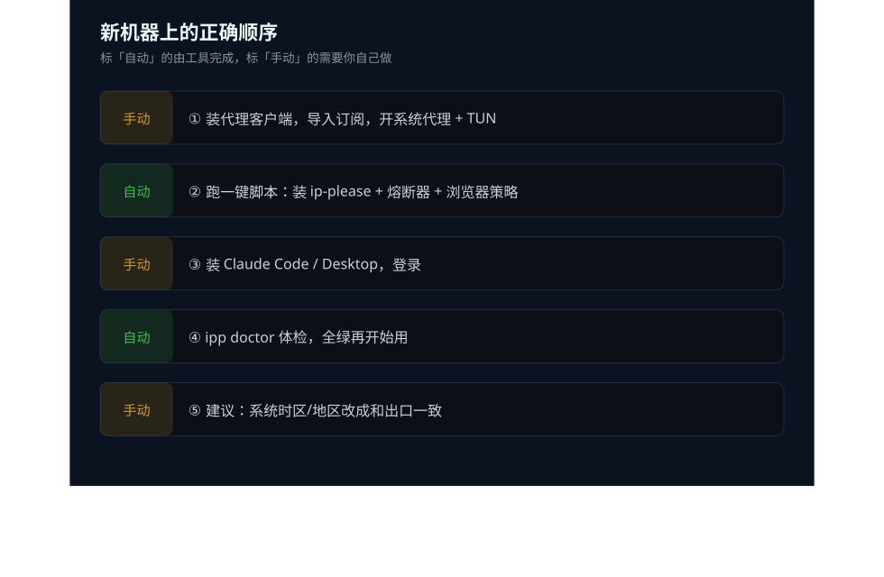
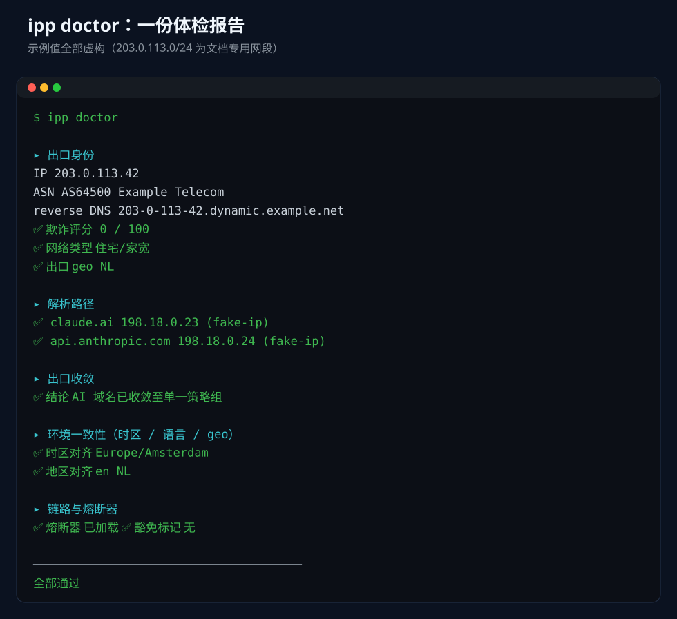
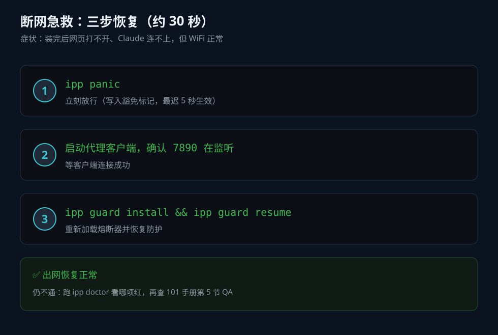

# ip-please 101 Handbook

For first-time users. After reading this you will know what it does, what is automated, what you must do yourself, and how to fix problems.

## Three sentences

- It governs your **egress identity**: what your AI account looks like on the network.
- It does three things: **audit the exit**, **plug the leak paths**, **cut the network when the proxy dies**.
- It does **not** install a proxy, log you in, or touch passwords and payments.

## Automated vs manual

| Task | Who | Notes |
|---|---|---|
| Install Homebrew | script (asks password) | skipped if present |
| Install `ip-please` | **automatic** | brew or pkg |
| Install system breaker (pf + launchd) | **automatic** (sudo once) | |
| Browser WebRTC / QUIC policies | **automatic** | restart browser |
| Claude Code telemetry off | **automatic** | writes `~/.claude/settings.json` |
| Disable IPv6 | **automatic** | prevents v6 bypass |
| Claude Desktop training-data opt-out | **manual** | Settings → Privacy → turn off "Help improve Claude" |
| Claude Desktop crash/analytics telemetry | **not exposed** in consumer builds | only enterprise managed config (`disableEssentialTelemetry` / `disableNonessentialTelemetry`) |
| Install proxy client | **manual** | |
| Import subscription, pick node | **manual** | |
| Enable System Proxy + TUN | **manual** | |
| Install and sign in to Claude | **manual** | |
| Align timezone/region with exit | **manual** (recommended) | |

## Day 0 flow



1. Install a proxy client, import your subscription, enable System Proxy + TUN; make sure `https://claude.ai` opens.
2. Run the installer:
   ```bash
   bash -c "$(curl -fsSL https://raw.githubusercontent.com/zahT3/ip-please/main/scripts/quickstart.sh)"
   ```
3. Install Claude Code or Claude Desktop and sign in.
4. Run `ipp doctor`; all green means done.


5. Recommended: set macOS region/timezone to match the exit country.

## Daily use

```bash
ipp doctor          # audit
ipp guard pause     # before changing proxy settings
ipp guard resume    # after
```

`ipp egress` after subscription updates; `ipp panic` as the emergency release; `ipp doctor --redact` for screenshots.

## FAQ highlights

- **No internet after install**: the breaker tripped. Run `ipp panic`, start the proxy client, then `ipp guard install && ipp guard resume`.

  
- **`command not found`**: add Homebrew to PATH (`eval "$(/opt/homebrew/bin/brew shellenv)"`).
- **`Operation not permitted`**: grant Full Disk Access to Terminal.
- **Breaker flaps**: check the client port (default 7890) and `/etc/ip-please/guard.conf`.
- **TUN not active**: enable the client's TUN/enhanced mode and restart it.
- **Exit still domestic**: system proxy → TUN → policy group not DIRECT.
- **WebRTC still leaks**: fully quit and reopen Chrome/Brave; verify `chrome://policy`.
- **Subscription update turned `egress` red**: `ipp egress --fix`, restart client.
- **Environment mismatch**: align system timezone/region, or keep `FINGERPRINT_STRICT=0`.
- **pkg blocked**: right-click → Open, or System Settings → Privacy & Security → Open Anyway.
- **Upgrade**: `brew upgrade ip-please` then `"$(brew --prefix ip-please)/libexec/install.sh"`.
- **Uninstall**: `"$(brew --prefix ip-please)/libexec/uninstall.sh" && brew uninstall ip-please`.

Full details (in Chinese): [handbook.zh-CN.md](handbook.zh-CN.md).

## Client compatibility

The breaker and probes (`ip`, `risk`, `fingerprint`, `residue`) are client-agnostic — they only need a local proxy port (`PROXY_PORT`, default 7890) plus TUN. The `egress` policy-group audit needs a Clash-family YAML profile (FlClash, Clash Verge Rev, ClashX, mihomo, Stash); sing-box / Surge / V2Ray configs are not parsed. Profile discovery auto-scans common locations; override with `--profile` or `PROFILE_DIR`. `ipp egress --fix` validates that `AI_GROUP` exists in the subscription before writing, and lists available group names otherwise.

## Account-side checklist (manual)

1. Turn off **Help improve Claude** (Settings → Privacy) so chats are not used for training.
2. Enable 2FA.
3. One account, one fixed egress — do not hop countries daily.
4. No shared accounts.
5. Billing region consistent with the account region; no gift-card arbitrage.
6. Never hand session tokens/cookies to third-party panels.
7. Separate browser profiles per account.
8. Keep the signup email/phone stable.
9. Keep request volume human.
10. No unknown "Claude enhancer" extensions.

## Boundaries

Account hygiene (passwords, 2FA, sharing, billing region), request behaviour, content, proxy node quality, and Claude Desktop telemetry are out of scope — the account-side checklist above lists the manual steps. The tool covers the network egress surface only.

## Glossary

Exit identity · residential vs datacenter IP · fraud score · TUN · fake-ip · egress convergence · circuit breaker · exemption flag · STUN/WebRTC.
