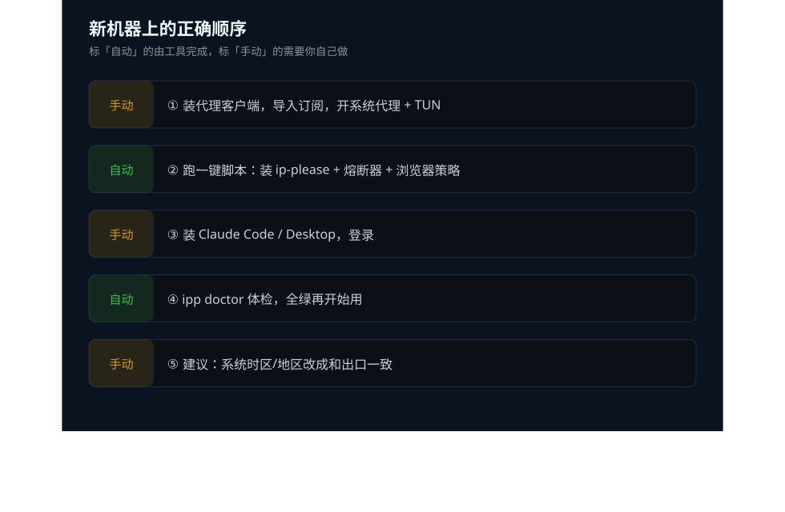
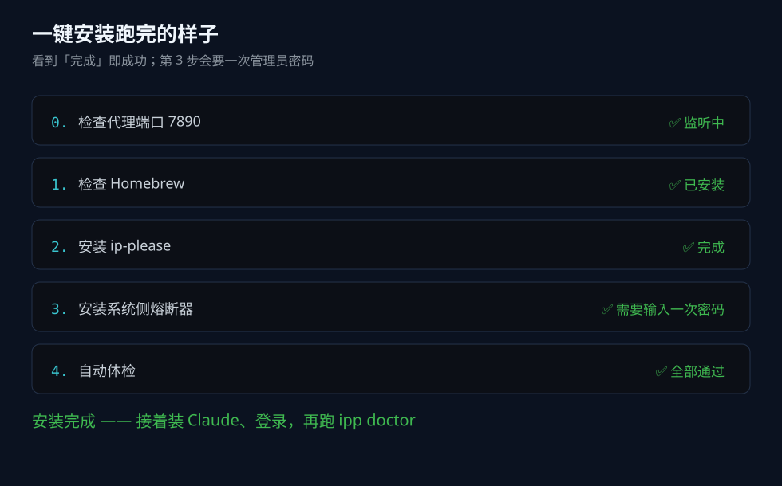
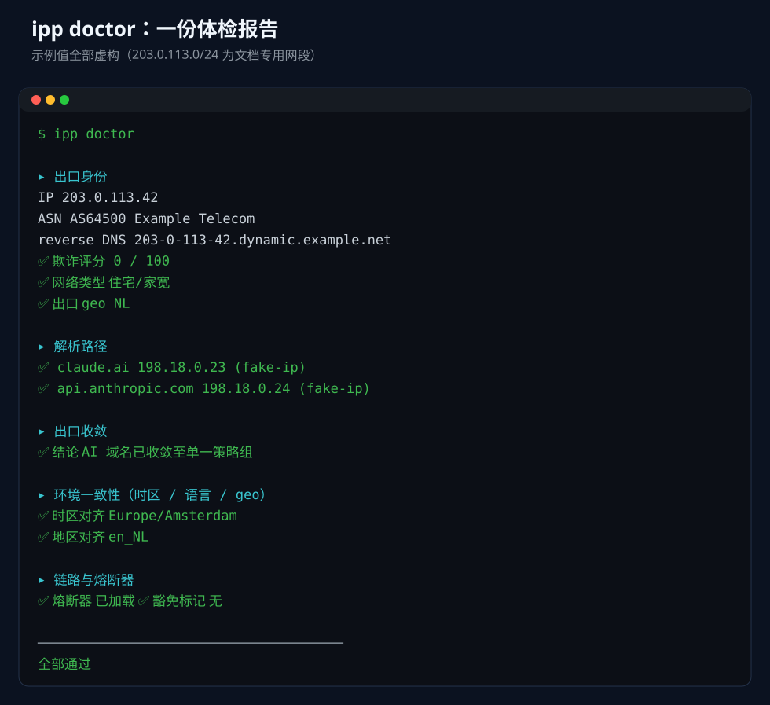
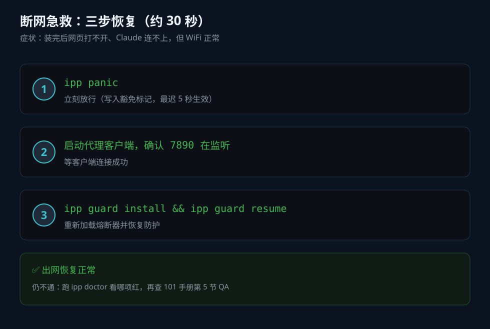

# ip-please 101 手册

给第一次接触这个工具的人。读完你会知道：**它做什么、哪些事它替你做了、哪些必须你自己做、出了问题怎么办。**

---

## 0. 三句话版本

- 它管的是**网络出口**：你的 AI 账号对外看起来像从哪里上网。
- 它只做三件事：**体检出口身份**、**堵住泄漏路径**、**代理断线时自动断网**。
- 它**不装代理、不登录账号、不碰密码和支付**——那部分要你自己来。

---

## 1. 全自动 vs 必须手动

装完之后对照这张表，就知道"还差什么"。

| 事情 | 谁做 | 说明 |
|---|---|---|
| 安装 Homebrew | 脚本（需你输密码） | 已装则跳过 |
| 安装 `ip-please` 本身 | **全自动** | brew 或 pkg |
| 安装系统侧熔断器（pf + launchd） | **全自动**（要 sudo 密码） | 装机时一次 |
| 关闭浏览器 WebRTC / QUIC | **全自动** | 重启浏览器生效 |
| 关闭 Claude Code 遥测 | **全自动** | 写进 `~/.claude/settings.json` |
| 关闭 IPv6 | **全自动** | 防止 v6 绕过代理 |
| 关掉 Claude Desktop 遥测 | ❌ 做不到 | 消费版没有开关 |
| 安装代理客户端（FlClash / Clash Verge / sing-box） | **手动** | 需要你下载 |
| 导入机场订阅、选节点 | **手动** | 需要你的订阅链接 |
| 打开「系统代理」和「TUN」 | **手动** | 客户端里的两个开关 |
| 安装 Claude Code / Claude Desktop | **手动** | 官方渠道 |
| 登录 Claude 账号、支付订阅 | **手动** | 账号与支付 |
| 把系统时区/地区改成和出口一致 | **手动**（建议） | 否则体检会红 |
| 每次开机启动代理 | **手动**（建议开自启） | 客户端设置里勾选 |

> 一句话：**它把"网络防护"全自动了，"代理"和"账号"这两块必须你自己做。**

---

## 2. 新机器完整流程（Day 0）



### 第 1 步：装代理，先让网络通

1. 下载代理客户端（例如 [FlClash](https://github.com/chen08209/FlClash/releases)）
2. 导入你的订阅
3. 打开 **系统代理** 和 **虚拟网卡 / TUN**
4. 浏览器能访问 `https://claude.ai` 即算成功

### 第 2 步：跑一键安装

把下面整行复制到「终端」（`Command + 空格` 搜"终端"）：

```bash
bash -c "$(curl -fsSL https://raw.githubusercontent.com/zahT3/ip-please/main/scripts/quickstart.sh)"
```

它会：检查代理 → 装 Homebrew（如果没有）→ 装工具 → 装系统防护（**会要一次密码**）→ 自动体检。



### 第 3 步：装 Claude，登录

Claude Code（命令行）或 Claude Desktop（图形界面）任选，装好后登录。

### 第 4 步：自检

```bash
ipp doctor
```

看到 `全部通过` 即完成。有红色项就翻第 5 节。



### 第 5 步（建议）：对齐时区

系统设置 → 通用 → 语言与地区 → **地区**改成出口国家。否则体检的"环境一致性"会提示不一致。

---

## 3. 三种安装方式

| 方式 | 适合谁 | 命令/操作 |
|---|---|---|
| 一键脚本 | 不想看代码 | 上面那一行 |
| Homebrew | 熟悉命令行 | `brew install zahT3/tap/ip-please` 然后 `"$(brew --prefix ip-please)/libexec/install.sh"` |
| `.pkg` 安装包 | 想双击安装 | [Releases](https://github.com/zahT3/ip-please/releases/latest) 下 `-arm64.pkg`；未签名，首次要右键「打开」或系统设置里放行 |

装完都跑一次 `ipp doctor` 验证。

---

## 4. 日常怎么用（三条命令就够了）


```bash
ipp doctor          # 体检：出口身份、泄漏面、环境一致性、熔断器
ipp guard pause     # 动代理之前先暂停防护（比如换节点、升级客户端）
ipp guard resume    # 改完再恢复防护
```

其余命令平时用不到：

| 命令 | 什么时候用 |
|---|---|
| `ipp egress` | 订阅更新后确认所有 AI 域名还走同一个策略组；红了就跑 `ipp egress --fix` |
| `ipp ip` | 只看出画像：住宅还是机房、欺诈分、国家（前提是探针域名已钉进 AI 组，否则测的是默认路由） |
| `ipp residue` | 换账号前扫描本地残留 |
| `ipp panic` | 断网急救（见第 5 节第一条） |
| `ipp recover [--restart]` | FlClash 崩溃后一键恢复：暂停熔断、清 DNS/代理残留、可选重启客户端 |
| `ipp activity` | 检查 Claude 是否在活动（暂停/重启前的强制检查） |
| `ipp guard pause --for 180` | 带时限的暂停，到点自动恢复，防止忘记 |
| `ipp doctor --redact` | 体检结果脱敏，方便截图发群里 |

---

## 5. QA：遇到问题怎么办

**通用第一步永远是：跑 `ipp doctor`，看哪一项是 ❌ 或 ⚠️，再对照下面找。**

### Q1：装完之后上不了网了

**原因**：代理断了，熔断器按设计 fail-closed 把网页端口挡住了。



**急救（30 秒）**：

```bash
ipp panic                                   # 1. 立刻放行（最迟 5 秒生效）
# 2. 启动代理客户端，确认 7890 有监听
ipp guard install && ipp guard resume       # 3. 重新加载熔断器并恢复防护
```

`ipp panic` 会写一个豁免标记 `~/.ip-please-pause`，即使没有 sudo 权限，熔断器下一轮也会自行放行。想手动兜底：

```bash
touch ~/.ip-please-pause
sudo launchctl bootout system /Library/LaunchDaemons/local.ip-please.guard.plist
sudo pfctl -a ip-please-guard -F rules
```

网络恢复后重新武装：

```bash
rm -f ~/.ip-please-pause
ipp guard install && ipp guard resume
```

### Q2：提示 `ipp: command not found`

Homebrew 的 bin 目录不在 PATH。执行（Apple Silicon）：

```bash
echo 'eval "$(/opt/homebrew/bin/brew shellenv)"' >> ~/.zshrc
source ~/.zshrc
```

Intel Mac 把 `/opt/homebrew` 换成 `/usr/local`。

### Q3：`Operation not permitted`

终端缺少完全磁盘访问权限。系统设置 → 隐私与安全性 → **完全磁盘访问权限** → 把「终端」加进去，然后重启终端。

### Q4：熔断器反复跳闸，网络一会儿通一会儿断

说明它认为代理端口不可达。检查：

1. 客户端端口是不是 7890（不是的话改 `/etc/ip-please/guard.conf` 里的 `GUARD_PROXY_PORT`）
2. 客户端是否在运行
3. `ipp guard status` 看当前状态

### Q5：体检显示 TUN 未接管

客户端里把「虚拟网卡 / TUN」打开；有些客户端叫「增强模式」。打开后重启客户端，再跑 `ipp doctor`。

### Q6：出口 IP 还是国内地址

按顺序查：系统代理开关 → TUN 开关 → 策略组是不是选到了「直连/DIRECT」→ `ipp doctor` 的「出口收敛」是否多个策略组。

### Q7：浏览器还能查出真实 IP（WebRTC 泄漏）

1. 确认 Chrome/Brave **完全退出**再重启（策略是启动时读的）
2. 打开 `chrome://policy` 看有没有 `WebRtcIPHandling`，状态是否 OK
3. 没有的话重跑安装脚本

### Q8：Claude 频繁要验证码 / 二次验证

先跑 `ipp doctor` 看出口是不是住宅 IP、是不是单一策略组、时区是否对齐。都正常的话，通常是账号行为或内容触发，不在工具范围（见第 6 节）。

### Q9：订阅更新后体检变红

订阅文件被覆盖，之前钉的规则丢了。跑：

```bash
ipp egress --fix
```

然后重启代理客户端。

### Q10：环境一致性报"时区/地区不一致"

两种做法：把系统时区/地区改成出口国；或者接受提示、用 `FINGERPRINT_STRICT=0`（默认就是 0，只对中文/日文/韩文语言判失败）。

### Q11：`.pkg` 双击被系统拦住

右键点安装包 → **打开**；或系统设置 → 隐私与安全性 → **仍要打开**。因为目前没有 Apple 开发者签名。

### Q12：想升级

```bash
brew upgrade ip-please
"$(brew --prefix ip-please)/libexec/install.sh"   # 让系统侧组件也更新
```

### Q13：想彻底卸载

```bash
"$(brew --prefix ip-please)/libexec/uninstall.sh"
brew uninstall ip-please
rm -f ~/.ip-please-pause
```

### Q14：安装脚本提示要安装 Xcode Command Line Tools

正常，第一次装 Homebrew 需要它。等弹窗装完（几分钟），再重新跑脚本。

### Q15：我用的不是 FlClash / 不是 Clash 系客户端

熔断器、`ip`、`risk`、`fingerprint`、`residue` 照常可用（改 `PROXY_PORT` 即可）。只有 `egress` 依赖 Clash 系 YAML 订阅；sing-box / Surge / V2Ray 会提示找不到 profile，这属于预期。详见第 7 节。

### Q16：「Help improve Claude」在哪关？

Claude 网页版或桌面客户端 → 设置（Settings）→ 隐私（Privacy）→ 关掉 **Help improve Claude**。关掉后新对话不会再用于训练。这是账号设置，工具无法代劳。

### Q17：面板显示"机房"，`ipp ip` 却显示"住宅"，信谁？

两个可能，按顺序查：

1. **`ipp ip` 测的路径不是 Claude 的路径**。它访问的是 `ipinfo.io`，如果订阅里没有把 `ipinfo.io` 钉进 AI 策略组，这条请求会命中最后的 `MATCH` 规则（通常是直连或主节点），测到的自然不是 Claude 的出口。
   - 新版本会在 `ipp egress` 里直接提示：`探针路径 ipinfo.io 走 🐟 漏网之鱼`
   - 解决：`ipp egress --fix` 会把 `ipinfo.io` / `api.scamalytics.com` 一起钉进 AI 组，然后**重启代理客户端**再跑 `ipp ip`
2. **节点名字骗人**。机场把机房 IP 叫「家宽 05」很常见。改完后如果 `ipp ip` 显示机房 ASN（如 Akari Networks）且没有反查，那就是机房。

判断依据永远是三件套：ASN 归属、反向域名（`dynamic`/`ppp`/`broadband` 才是家宽）、欺诈分。

### Q18：切了节点，`ipp ip` 的结果却一直不变

两个原因，都正常：

1. **10 分钟缓存**：出口信息缓存 10 分钟，避免每次检查都打接口。加 `--refresh` 强制刷新：
   ```bash
   ipp ip --refresh
   ```
2. **信息源限流**：`ipinfo.io` 免费额度是按 IP 算的，走共享节点时容易 429。新版本会自动回退到 `ip-api.com`（拿国家、ASN、反查、hosting 标记），不需要你处理。

手动清缓存也可以：

```bash
rm -f "${TMPDIR:-/tmp}/ip-please-exit-$(id -u).cache"
ipp ip
```

### Q19：FlClash 升级后，自定义规则没了 / 脚本不生效

FlClash 升级或订阅更新会**重写 profile 文件**，直接改 profile 的自定义规则会丢。正确做法是把自定义规则放进「脚本（Scripts）」里，并确保脚本被选中。

排查三步：

```bash
# 1. 当前订阅绑定的是哪个 profile、是否绑了脚本
sqlite3 "$HOME/Library/Application Support/com.follow.clash/database.sqlite" \
  'select id,label,script_id from profiles;'

# 2. 运行时配置里有没有你的自定义规则（以 ToDesk 为例）
grep -c 'ToDesk' "$HOME/Library/Application Support/com.follow.clash/config.yaml"

# 3. 脚本文件是否还在
ls "$HOME/Library/Application Support/com.follow.clash/scripts/"
```

`script_id` 为空 = 脚本没绑定；运行时配置里搜不到 = 没生效（`respect-rules: false` 也是脚本未应用的典型迹象）。

修复：FlClash → 配置（Profiles）→ 选中订阅 → **脚本（Scripts）** → 选回 `Tailscale Bypass` → 保存并重载，再用上面第 2 步确认。

> `ip-please` 0.6.1 起会从 FlClash 数据库读取**当前活动 profile**，不再按文件修改时间猜，避免 `--fix` 改到没在用的那份。
> 0.6.2 起 `ipp egress` 优先审计 **FlClash 运行时配置**（`config.yaml`，已包含脚本注入的规则），所以看到的结果就是实际生效的路由；改完脚本后需要重载/重启 FlClash，运行时配置才会重新生成。

### Q20：120 秒宽限期里会不会直连泄漏真实 IP

分两种情况：

| 情况 | 会不会泄漏 |
|---|---|
| 客户端还在，只是 7890 端口暂时不通（重载配置、切节点） | **不会**。TUN 还在，流量仍被送进隧道，连接失败而不是直连 |
| 客户端完全退出/崩溃，TUN 网卡消失 | **会**。此时系统默认路由回到物理网卡，代理失效后的流量可能直接出去 |

所以宽限期只在“TUN 还在”时才有意义。0.6.3 起熔断器会先检查 TUN：

- **TUN 消失** → 跳过宽限，**立即阻断**（`log: tun interface missing -> skip grace`）
- **TUN 在、端口掉** → 保留 120 秒宽限，给客户端重启
- 想更严格：`/etc/ip-please/guard.conf` 里设 `GUARD_GRACE=30`
- TUN 网段不是默认的 `198.18.`（比如换了客户端）：设 `GUARD_TUN_PATTERN`

另外 `RELAUNCH_APP` 会在阻断时尝试拉起客户端一次，配合宽限期能覆盖“客户端闪退马上重启”的场景。

### Q21：FlClash 会莫名自己重启，怎么查、怎么防

**先查是不是多 TUN 抢路由**（最常见）：

```bash
ipp recover        # 会直接列出 Tailscale / OpenVPN / WireGuard 是否也在跑
```

macOS 上多个 TUN 同时改路由时，FlClash 的 TUN 会被覆盖，核心检测到后重建 TUN / 重启服务。日志特征：

```bash
log show --last 2h --style compact --predicate 'eventMessage CONTAINS "tun interface missing"' | tail
```

**预防**：

1. 用 FlClash 时退出其他 VPN（Tailscale、OpenVPN、WireGuard），只留一条隧道
2. 必须共存时，把对方的网段加进 FlClash 的 TUN 排除（Tailscale 的 `100.64.0.0/10` 已在脚本里）
3. FlClash 崩溃后**完全退出**（⌘Q，确认 `pgrep -x FlClashCore` 为空）再重开，不要只关窗口
4. 动 FlClash 前先 `ipp guard pause`，服务确认恢复后再 `ipp guard resume`

**恢复**：

```bash
ipp recover              # 清理残留并等待 FlClash 自己恢复
ipp recover --restart    # 顺带退出并重开 FlClash
```

`ipp recover` 做的事：暂停熔断器 → 关闭指向死端口的系统代理 → DNS 从 `198.18.x` 恢复 DHCP → 刷新 DNS 缓存 →（可选）重启 FlClash → 等待 7890 与 TUN 就绪 → 恢复熔断器。失败时保持暂停，不会把你锁死。

### Q22：怎么避免"暂停熔断时 Claude 正在跑"这种失误

三个层面一起用：

1. **工具门禁**：`ipp guard pause` 和 `ipp recover --restart` 现在会先跑活动检测；Claude Desktop/CLI 在活动、或代理上有 Claude 连接时直接拒绝，必须加 `--force`。
2. **带时限的暂停**：`ipp guard pause --for 180`，熔断器到点自动恢复（`guard.sh` 会删除过期的豁免标记），不会因为忘记 resume 而长时间裸奔。
3. **Agent 规则**：仓库 `AGENTS.md` 里写了强制流程——先 `ipp activity`，busy 就停；暂停必须带 `--for`；操作完必须 `guard status` 复核。

紧急情况仍然用 `ipp panic`（不受门禁限制）。

### Q23：报错但我不确定该发什么给人看

跑：

```bash
ipp doctor --redact
```

把输出截图发出去即可——IP、用户名、订阅 ID 都会被替换成示例值。

---

## 6. 它不负责什么

- **账号本身**：密码强度、2FA、是否多人共用、支付方式与地区
- **内容与行为**：请求频率、生成内容是否触发审核
- **代理**：节点质量、订阅、是否被墙
- **Claude Desktop 遥测**：消费版界面没有遥测开关；训练数据开关（Help improve Claude）要手动关，见第 8 节清单

工具的边界是**网络出口面**。把这一面做干净能显著降低风控概率，但不等于"账号绝对不会被封"。

---

## 7. 客户端兼容性：不是 FlClash 也能用

**核心功能与客户端无关**，只要本机有本地代理端口 + TUN：

| 能力 | 依赖什么 | 非 Clash 客户端 |
|---|---|---|
| 熔断器（代理断线自动阻断） | 本地端口是否可连（默认 7890，可改 `PROXY_PORT`） | ✅ 通用 |
| `ipp ip` / `ipp risk` | 一次 HTTPS 请求 | ✅ 通用 |
| `ipp fingerprint` | 系统时区/语言/地区 | ✅ 通用 |
| `ipp residue` | 本地文件路径 | ✅ 通用 |
| `ipp dns`（fake-ip 断言） | Clash 系 TUN 的 fake-ip 网段 | ⚠️ 仅适用 Clash 系 TUN |
| `ipp egress`（策略组审计 / `--fix`） | **Clash 系 YAML 订阅**里的 `rules:` + `proxy-groups:` | ❌ 不适用 sing-box / Surge / V2Ray |

### 订阅命名不同怎么办

每个机场的策略组名字都不一样（「节点选择」「Proxy」「🚀 自动选择」…）。两个地方要对上：

```bash
# ~/.config/ip-please/config.sh（brew 安装也能用，不用动 libexec）
AI_GROUP="你的 AI 策略组名字"     # egress 审计与 --fix 往哪组钉规则
PROXY_PORT=7890                  # 你客户端的混合端口
RELAUNCH_APP="Clash Verge"       # 可选：熔断后尝试拉起的 app 名
PROFILE_DIR="~/Library/Application Support/<客户端>/profiles"
```

改配置有三种方式，优先级从低到高：内置默认值 → `~/.config/ip-please/config.sh` → 仓库里的 `config.sh`（开发用）。临时测试也可以直接给环境变量：`AI_GROUP="🧲 海外AI" ipp egress --fix`。

- `ipp egress --fix` **会先校验**这个组名是否存在于订阅里；不存在会拒绝写入并列出可用组名，不会把你的配置写坏。
- 订阅目录不同：默认自动探测常见位置；找不到时 `ipp egress --profile ~/path/to/config.yaml`，或在 `config.sh` 设 `PROFILE_DIR`。

### 没有 TUN / 只用系统代理的客户端

熔断器仍然有效（它只判断端口），但 `dns` 的 fake-ip 断言不适用（没有 fake-ip 就会显示解析路径异常）。这类客户端建议在客户端里开启 TUN 再跑体检。

## 8. 账号侧设置清单（手动，建议逐条做）

网络出口只是风控的一半，另一半在账号本身。这些工具做不了，但值得照着点一遍：

| # | 做什么 | 在哪 |
|---|---|---|
| 1 | 关掉「Help improve Claude」（不拿你的对话训练模型） | Claude 网页/客户端：设置 → 隐私 → Privacy → 关 **Help improve Claude** |
| 2 | 开启两步验证（2FA） | 账号设置 → 安全 |
| 3 | 一个账号固定一个出口，不要今天日本明天美国 | 客户端里给账号固定节点 |
| 4 | 不与人共享账号、不买「共享号」 | —— |
| 5 | 支付方式与账号地区保持一致，别用代付/礼品卡套利 | 账号设置 → 账单 |
| 6 | 不把会话 token / cookie 交给第三方面板、中转站 | —— |
| 7 | 浏览器按账号隔离（不同 profile），别同一浏览器来回切换 | Chrome/Brave 的用户配置 |
| 8 | 注册邮箱/手机号保持稳定，别频繁换 | —— |
| 9 | 控制请求频率，别做批量自动化 | —— |
| 10 | 不装来路不明的「Claude 增强插件」（可能劫持会话） | —— |

> 工具能保证的是**网络出口一致**；上面这些是**身份与行为一致**。两者都做到，风控概率才最低。

## 9. 安全说明

- 不收集、不上传任何数据；没有任何后端
- 体检只访问公开的 IP 信息接口（ipinfo / scamalytics；限流时回退 ip-api.com），不经过任何自建后端
- 安装脚本会写 `/etc`、加载 launchd、写浏览器策略，全部代码都在仓库里可审
- 许可证 MIT

---

## 10. 术语表

| 词 | 含义 |
|---|---|
| 出口身份 | 你的流量到了对端时，对方看到的 IP / ASN / 国家 / 反查域名 |
| 住宅 IP / 机房 IP | 前者属于宽带用户，后者属于数据中心；后者更容易被风控 |
| 欺诈分 | 第三方对 IP 的风险评分，0 最好 |
| TUN | 客户端在系统层接管全部流量的模式 |
| fake-ip | 客户端给域名分配的假地址（如 198.18.x.x），用于分流 |
| 出口收敛 | 所有 AI 相关域名都走同一个节点，不出现"一个请求两个 IP" |
| 熔断器 | 代理失联时自动阻断出网的机制 |
| 豁免标记 | `~/.ip-please-pause`，存在时熔断器不动作 |
| STUN / WebRTC | 浏览器用来打洞的协议，可能绕过代理暴露真实 IP |

---

## 11. 求助

- 提 Issue：<https://github.com/zahT3/ip-please/issues>（附 `ipp doctor --redact` 输出）
- 先搜已有 Issue，多半有人踩过同样的坑
